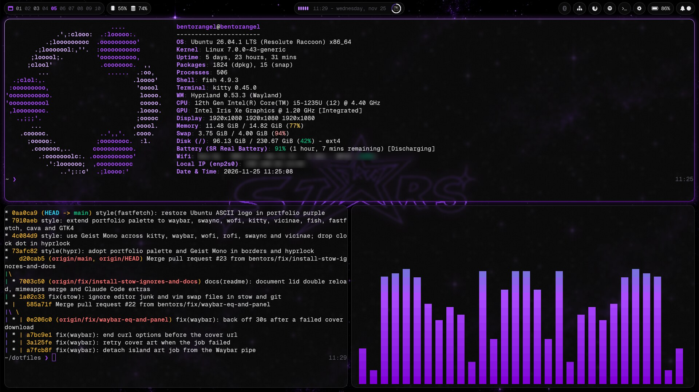
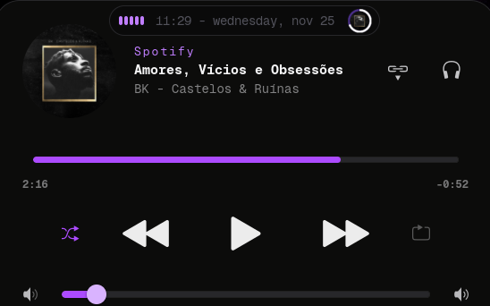
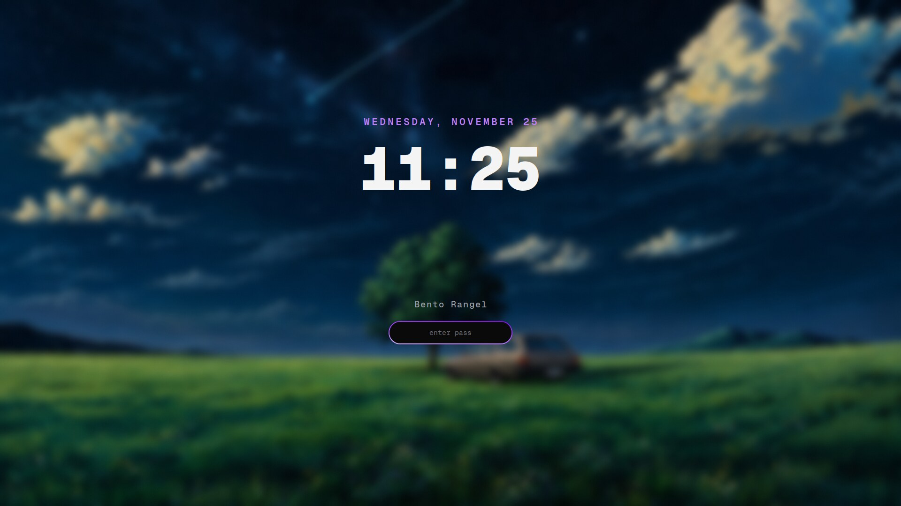
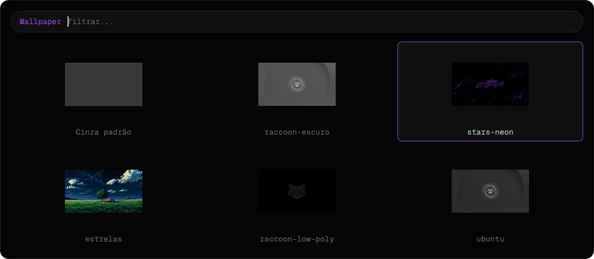
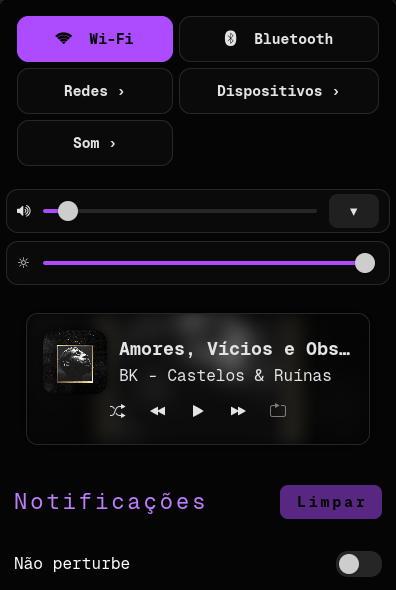

# dotfiles

Hyprland desktop on Ubuntu with a media "dynamic island" on the Waybar, styled after my
portfolio, [bentorangel.vercel.app](https://bentorangel.vercel.app): Geist Mono (Geist for UI text),
near-black surfaces with thin zinc borders, and a purple accent.

  



| Spotify panel on the island | hyprlock |
|---|---|
|  |  |
| **Wallpaper picker (`Alt+W`)** | **Notification center** |
|  |  |

## Look

One palette, taken from the portfolio's CSS, shared by every config:

| Role | Color |
|---|---|
| Background / surfaces | `#050505` / `#0a0a0a` / `#0f0f0f` |
| Borders | `#27272a` (zinc-800), purple at 50% on hover |
| Text | `#e4e4e7`, dimmed `#a1a1aa` / `#71717a` |
| Accent | `#ac4bff`, lighter `#c07eff` / `#d9b3ff`, deeper `#8200da` |
| Secondary accent | `#00d294` (emerald: charging, checks, cava peaks) |

The active window border is a `#d9b3ff → #ac4bff → #8200da` gradient with a faint
purple glow; Waybar workspaces read `01 02 03 …` like the portfolio's numbered sections.

## What's inside

| Path | What it is |
|---|---|
| `.config/hypr/` | Hyprland, hyprlock and hypridle configs, plus volume/backlight/wallpaper scripts |
| `.config/waybar/` | Bar config and style, and the dynamic island: clock, equalizer, album art ring |
| `.config/waybar/scripts/player-panel.py` | GTK4 Spotify panel that opens on hover over the island |
| `.config/kitty/` | Translucent near-black terminal with the palette as its ANSI colors |
| `.config/fastfetch/` | Fetch on terminal start, Ubuntu logo in purple |
| `.config/cava/` | Terminal audio visualizer with a purple to emerald gradient |
| `.config/vicinae/` | Launcher settings (`Super+Space`), Geist Mono and the `bento` theme |
| `.local/share/vicinae/themes/bento.toml` | vicinae theme with the portfolio palette |
| `.config/wofi/` | App menu style (`$menu` and the bar's launcher button) |
| `.config/swaync/` | Notification center with Wi-Fi, Bluetooth, volume and media controls |
| `.config/rofi/wallpaper.rasi` | Thumbnail grid used by `scripts/wallpaper` |
| `.config/fish/` | Minimal prompt (path and a purple `❯`), clock on the right, fastfetch greeting |
| `.config/fontconfig/` | Maps `monospace` to Geist Mono and `sans-serif` to Geist |
| `.config/gtk-4.0/gtk.css` | libadwaita accent and dark surfaces in the portfolio palette |
| `.config/mimeapps.list` | Zen Browser as the default for web links and HTML |
| `.gitconfig` | Git identity, GitHub auth through `gh` |
| `packages.txt` | apt packages the configs depend on |
| `.claude/` | Claude Code: global `CLAUDE.md`, status line, plugins, custom agents and skills |

## Keybinds

`Super` is the main modifier. Full list in `.config/hypr/hyprland.conf`.

| Keys | Action |
|---|---|
| `Super+Q` | Terminal (kitty) |
| `Super+Space` | Launcher (vicinae) |
| `Super+R` | App menu (wofi) |
| `Super+E` | File manager (nautilus) |
| `Super+B` | Browser (Zen) |
| `Alt+W` | Wallpaper picker |
| `Super+Shift+V` | Clipboard history |
| `Super+N` | Clear notifications |
| `Print` / `Shift+Print` | Screenshot of a region / of everything, copied to the clipboard |
| `Super+L` | Lock screen |
| `Super+Esc` | Power menu (nwg-bar) |
| `Super+M` | Exit Hyprland |
| `Super+Shift+R` | Reload the Hyprland config (autoreload is off) |
| `Super+C` | Close window |
| `Super+F` / `Super+Shift+F` | Maximize / fullscreen |
| `Super+V` | Toggle floating |
| `Super+J` | Toggle split direction |
| `Super+Arrows` | Move focus |
| `Super+Shift+Arrows` | Move window |
| `Super+Ctrl+Arrows` | Resize window |
| `Super+drag` / `Super+right-drag` | Move / resize with the mouse |
| `Alt+Tab` | Next window |
| `Super+1`…`0` | Go to workspace 1–10 |
| `Super+Shift+1`…`0` | Send window to workspace 1–10 |
| `Super+Tab` | Previous workspace |
| `Super+S` / `Super+Shift+S` | Scratchpad: toggle / send window |

## Install

Files are symlinked into `$HOME` with [GNU Stow](https://www.gnu.org/software/stow/),
so editing a config in place edits the repo:

```sh
sudo apt install -y git stow
git clone https://github.com/bentors/dotfiles ~/dotfiles
cd ~/dotfiles
grep -vE '^\s*(#|$)' packages.txt | xargs sudo apt install -y
stow .
# machine-local monitor layout, sourced by hyprland.conf (must exist, can be empty);
# do this before the first Hyprland login, or `source` shows a config error
cp --update=none .config/hypr/monitors.conf.example ~/.config/hypr/monitors.conf
# runtime-rewritten files are copied, not linked (--update=none never overwrites)
cp --update=none .config/waybar/art.css ~/.config/waybar/
cp --update=none .config/mimeapps.list ~/.config/
mkdir -p ~/.config/vicinae && cp --update=none .config/vicinae/settings.json ~/.config/vicinae/
mkdir -p ~/.claude && cp --update=none .claude/settings.json ~/.claude/
# hyprlock background (gitignored); without it hyprlock falls back to a solid color.
# Pick an image, or reuse the desktop one once scripts/wallpaper has set it:
# cp /path/to/image.png ~/.config/hypr/wallpaper.png
# ln -s desktop-wallpaper.png ~/.config/hypr/wallpaper.png
# fish as the login shell
chsh -s "$(command -v fish)"
# purple accent and Geist fonts for GTK/libadwaita apps (dconf, not a file)
gsettings set org.gnome.desktop.interface color-scheme 'prefer-dark'
gsettings set org.gnome.desktop.interface gtk-theme 'Yaru-purple-dark'
gsettings set org.gnome.desktop.interface accent-color 'purple'
gsettings set org.gnome.desktop.interface font-name 'Geist 11'
gsettings set org.gnome.desktop.interface document-font-name 'Geist 12'
gsettings set org.gnome.desktop.interface monospace-font-name 'Geist Mono 11'
```

`.stowrc` targets `$HOME`, so the clone can live anywhere, and links files one
by one (`--no-folding`), so app state written next to them stays out of the
repo. `.stow-local-ignore` skips `.claude/settings.json`, `waybar/art.css`,
`mimeapps.list` and `vicinae/settings.json`, which tools rewrite at runtime. If a file already exists,
`stow` refuses to replace it; move it away (or use `stow --adopt .` and review
`git diff`). `stow -D .` removes the links.

Wallpapers are not included; `scripts/wallpaper /path/to/image.png` sets one
(it writes `desktop-wallpaper.png`; the lock screen image is the separate
`wallpaper.png` from the install block).

Dependencies available in apt are listed in `packages.txt` (ImageMagick must
be 7, for `magick`). The rest comes from elsewhere:

- `vicinae` launcher.
- [Geist and Geist Mono](https://github.com/vercel/geist-font/releases): copy the
  `Geist/otf` and `GeistMono/otf` files from the release zip into
  `~/.local/share/fonts/geist/` and run `fc-cache -f`. Running apps (Waybar,
  swaync, the island panel) only pick up new fonts after a restart, not a reload.
- Zen Browser, unpacked in `~/.local/opt/zen/`. `mimeapps.list` expects
  `~/.local/share/applications/zen.desktop`, for example (`Exec` needs an
  absolute path: desktop files don't expand `$HOME` or `~`):

  ```ini
  [Desktop Entry]
  Type=Application
  Name=Zen Browser
  Exec=/home/YOUR_USER/.local/opt/zen/zen %u
  Categories=Network;WebBrowser;
  MimeType=text/html;x-scheme-handler/http;x-scheme-handler/https;
  ```
- Spotify (snap), which the island follows.
- Claude Code itself.
- Node.js/npm are in `packages.txt`; for the caveman CLI use a user prefix with
  `npm config set prefix ~/.npm-global` (fish already puts `~/.npm-global/bin`
  on `PATH`).

The bar and `Super+B` expect Zen Browser at `~/.local/opt/zen/zen`. The monitor
layout lives in `~/.config/hypr/monitors.conf`, outside the repo; match monitors
by `desc:` (see `monitors.conf.example` and `hyprctl monitors all`). It is the
single source of layout: with the lid closed and another monitor connected, the
lid script disables the internal panel; opening the lid runs `hyprctl reload`
so `monitors.conf` applies again, plus a second reload a second later (on 0.53.3
a reload that moves a monitor leaves Waybar and the wallpaper behind until the
next one). The script also runs on every reload and at login, where it only
disables the panel if the lid is closed, so `Super+Shift+R` while docked with the
lid closed briefly lights the panel before turning it off again. Plugging a
monitor in while the lid is already closed doesn't trigger it; reload once. `scripts/backlight` uses `brightnessctl -c
backlight`, which auto-detects the device (`DEVICE` in the script is only the
sysfs fallback). The swaync brightness slider is the exception: set
`backlight.device` in `.config/swaync/config.json` (currently `intel_backlight`)
for each machine.

If `~/.config/mimeapps.list` already exists, the install block leaves it alone;
merge the repo's entries into it to make Zen the default browser.

Config autoreload is off: a non-atomic save can make Hyprland parse a half-written
file, moving monitors to auto positions and, on 0.53.3, leaving Waybar and the
wallpaper at the old position. Reload with `Super+Shift+R` after editing.
That reload does not restart the `exec-once` daemons: after editing
`hypridle.conf`, run `pkill hypridle; hypridle & disown`.

## Claude Code

`stow .` links everything in `.claude/` except `settings.json`, which holds only portable keys
(theme, model, status line, attribution off, env, plugins and marketplaces); the install block
copies it with `cp --update=none` on a fresh machine. If `~/.claude/settings.json` already exists,
merge it in instead of overwriting. The status line needs `jq`; it also forwards
its input to `~/.orca/agent-hooks/claude-statusline.sh` when that file exists
(personal tooling, a no-op elsewhere). If the `ponytail` plugin isn't installed
on first launch, add it with `/plugin marketplace add DietrichGebert/ponytail`
and `/plugin install ponytail@ponytail`.
Credentials, history, memory and machine-specific hooks are never committed.

- `.claude/agents/`: subagents with a pinned model per role (`implementer`,
  `test-runner`, `code-searcher`, `reviewer`). `stow` links them file by file.
- `.claude/skills/`: `git-workflow` plus the superpowers process skills, vendored
  (MIT, see `SUPERPOWERS-LICENSE`) with the plugin disabled to skip its
  SessionStart context injection. Refresh by copying upstream `skills/` into
  `~/dotfiles/.claude/skills/` and running `stow .` (new files become links);
  `using-superpowers/SKILL.md` stays out on purpose (it is gitignored), and new
  upstream skill folders need a `!` line in `.gitignore`.

Not versioned, reinstalled by their own tools:

- Caveman skills (`caveman`, `ultracave`, `megacave`), hooks and MCP:
  `npm i -g @caveman-ai/cli && caveman setup --agent-native claude`
- claude.ai connectors come back with the login, but `settings.json` sets
  `ENABLE_CLAUDEAI_MCP_SERVERS=false` to keep them out of Claude Code; the
  `github` plugin is disabled too (the `gh` CLI covers it).
